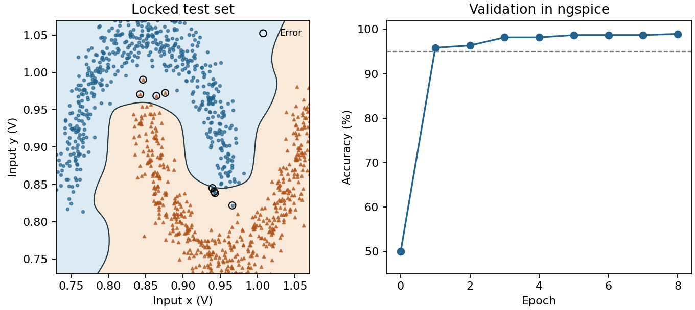

# Margin-gated diode network on two moons

The target for this nominal experiment is 95% accuracy at noise 0.10. The 64 training points and encoder are unchanged. An independent 384-point validation set (seed 913) guided architecture and training choices. The frozen test is 1,024 points (seed 20707), with the first 128 also presented in the original training transient. The comparison includes the same grid trained unconditionally, a zero-teaching run and a 20-presentation tighter-timestep check.

Local ngspice 41 runs use `accuracy.py`. Each case retains its generated deck, ngspice log and sampled state in `outputs/moons_accuracy_final/<case>/`. All runs use eight epochs except the short numerical check.

The final profile uses a 4 × 3 uniform grid, 2.4 V/V signed input drives about 0.90 V, 2.5 kΩ tail resistors, 0.33 pF storage capacitors and a 30 µV output-margin threshold. Seed 20707 was reserved after selecting this profile. An earlier lower-current pilot used a different test seed.

## Measured results

**The circuit classified 1,016/1,024 independent test examples correctly (99.22%).** Both classes had four errors. The original six-cell diode circuit scored 902/1,024 on the same points. Independent training on a second draw of 64 examples also produced 1,016/1,024 correct in ngspice.



| Measurement | Correct | Accuracy |
|---|---:|---:|
| Original training set | 63/64 | 98.44% |
| Validation set | 380/384 | 98.96% |
| Independent test, final-weight SPICE DC | 1,016/1,024 | 99.22% |
| First 128 independent examples, live transient | 127/128 | 99.22% |
| Independent test, second draw of 64 training points | 1,016/1,024 | 99.22% |
| Same grid, unconditional writes | 953/1,024 | 93.07% |
| Same grid, teaching current disabled | 512/1,024 | 50.00% |
| Previous six-cell diode network | 902/1,024 | 88.09% |

The original 128- and 512-point benchmarks scored 127/128 and 506/512 respectively. The independently trained Python circuit model also got 1,016/1,024 on the new test. With the SPICE weights, Python reproduced the final DC differential outputs to within 0.00001 µV RMS. The held-out live and DC decisions agreed on all 128 shared examples.

The circuit enabled 51 of 512 training write windows. Per-epoch counts were 20, 7, 2, 7, 4, 3, 5 and 3. The sampled write decisions agreed with the measured pre-nudge output for every presentation. All 128 test write windows stayed closed. Reducing the transient maximum timestep fourfold reproduced all first 20 write decisions, with at most 33.8 µV difference in a stored **weight** voltage.

The median absolute output differential on the locked test was 44.2 µV. Adding a uniform +30 µV offset at final readout reduced accuracy to 96.78%, and −30 µV gave 97.17%. This sensitivity check models a readout offset only. The ngspice runs use matched devices, ideal shared input drives and an ideal margin comparator. Noise and device mismatch during writing remain untested at this network scale.

[Results](reference/dense-bank/results.json) · [36 trained weights](reference/dense-bank/trained_weights.csv) · [Held-out voltages and labels](reference/dense-bank/test_readout.npz) · [Python validation sweep](reference/dense-bank/validation.csv)

## Learning and inference

Each input pair drives twelve localized diode cells. Each cell has five PN diodes and a resistor to ground. It connects through one trainable bridge to the bias and one to each of the two outputs. The network therefore has 60 activation diodes, 12 tail resistors and 36 local varactor bridges. Four x centers and three y centers require 14 shared signed input drives. All centers are uniformly spaced and fixed.

On each labelled presentation, one shared sample-and-hold tracks the free output difference from 8 to 12 µs. The teacher compares that voltage, with the sign of the label, to 30 µV. Below threshold it enables the original output nudge and the local bridge write windows. Above threshold it leaves the writer buses parked and the capacitors isolated. The cell locations, bridge capacitances and write thresholds are fixed for the entire run. Every weight starts at 1.55 V. All weight changes in the SPICE training run occur inside the bridge subcircuits.

At test time the target drive goes to zero, the teaching conductance turns off and the write switches stay open. The 128 live reads use the charge retained in the uninterrupted training transient. The full 1,024-point test uses a separate DC deck with the final ngspice capacitor voltages held fixed. Both measurements use the sign of the free output voltage difference. The first 128 points of the full set are the same examples used for the live check.

The unconditional-write control uses the same 12 cells, 36 bridges, 0.33 pF stores and example order. The clocked zero-teacher control sets the teaching conductance to zero. A second full transistor simulation repeats the gated learning protocol on a separately drawn set of 64 labelled examples (dataset seed 100) and uses that training set's encoder extrema. It is evaluated on the same raw test points.

## Reproduction

From this directory, use the repository Python environment and ngspice 41.

```sh
python model.py --activation dense-bank
python run.py --activation dense-bank --ngspice /path/to/ngspice
python accuracy.py --case validation
```

The first command runs the independent Python circuit model. The second performs training, controls, an independent training repeat and the report. The third replays the Python validation sweep over storage capacitance and margin threshold for the final grid. Each case can also be run separately using `accuracy.py --case`. The results directory contains per-presentation capacitor voltages, write decisions, live readbacks, reproducible SPICE decks, controller logs and final weights.
