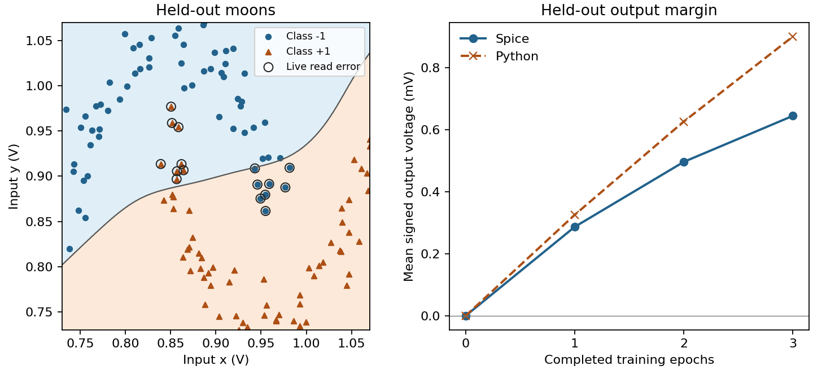

# Nonlinear hidden cells for two moons

Six current-steering cells give the 18-bridge network a curved decision boundary. After three training epochs, ngspice classified 112 of 128 held-out examples correctly in the same transient. Replacing each cell's current response with an affine function of the inputs reduced this to 105 of 128. Both circuits used the same 18 trainable bridges, initial capacitor voltages, example order and clock sequence.



## What the circuit computes

Each cell has five matched NPN transistors with a common emitter and a 48 µA tail current. The center transistor sinks current from the hidden node. Its base sits at 0.74 V. Four competing transistors receive base voltages of 0.70 V plus or minus the difference between an input coordinate and the cell's center. Their collectors connect to the supply.

When both coordinates are near the center, the hidden-node transistor takes a large share of the tail current. Moving away along either axis raises a competing base voltage and diverts that current. In forward-active operation its collector current is

```
Ic(x,y) = α Itail / [1 + 2 exp(−40 mV/VT) (cosh((x−cx)/VT) + cosh((y−cy)/VT))]
```

Here α = β/(β+1), β = 1000 and VT is the thermal voltage at 27 °C. In a standalone ngspice sweep, the center current reached 25.892 µA. At each of the six centers, its corresponding cell drew the largest current. The analytic model and transistor currents differed by at most 0.007 nA across the six centers and a 25 × 25 input grid.

The centers occupy the middle of six equal bins on a 3 × 2 grid over 0.73–1.07 V. Each hidden node has a bridge to the 1.03 V bias and one bridge to each output. There is no direct input-to-output connection. A training example supplies only x and y to the cell bank. The label controls the output nudge. All 18 capacitor weights participate in the same local write protocol as the original circuit. The cell centers and widths are fixed. The Python model computes the cell currents from the expression above, solves the loaded network, and trains its own weights.

The 18 bridges contain 252 MOSFETs. The six hidden cells add 30 NPNs and six tail-current sources. Ten shared linear level shifters generate the signed base drives for the five distinct coordinate centers. The SPICE deck uses ideal sources for the shifters, tail currents, biases and teaching signal. The six-cell topology was chosen as a compact option after comparing fixed grid sizes and widths on the 64 training points. The 48 µA bias gives about 0.81 V minimum hidden voltage at the final free training reads, above the 0.74 V center base.

## Results and controls

| Condition | Training, 64 points | Original held-out, 128 points | Fresh moons, 512 points |
|---|---:|---:|---:|
| Nonlinear cells, transistor SPICE | 61/64 (95.3%) | 112/128 (87.5%) | 463/512 (90.4%) |
| Independently trained Python model | 61/64 (95.3%) | 112/128 (87.5%) | 463/512 (90.4%) |
| Same bridge topology, affine cell responses | 56/64 (87.5%) | 105/128 (82.0%) | 441/512 (86.1%) |
| Linear logistic regression on the raw inputs | 61/64 (95.3%) | 108/128 (84.4%) | 454/512 (88.7%) |

The original 128 test points were presented immediately after training with the teacher and write switches disabled. The fresh set uses seed 2026, the original training-set voltage scaling, and a transistor DC replay with capacitor voltages fixed at their final learned values. Neither set supplied training writes. The two circuits with the teacher disabled throughout each scored 64/128. The affine control replaces each cell current with its least-squares plane over a uniform 41 × 41 voltage grid, independent of the moons labels.

At the final learned weights, a 25 × 25 ngspice voltage sweep deviated from its best-fitting output plane by 0.417 mV RMS for the nonlinear circuit. The affine control stayed within 10⁻¹¹ mV RMS of its plane. Python and the nonlinear SPICE transient agreed on all 128 decisions. The mean signed held-out margin was 0.645 mV in SPICE and 0.900 mV in Python. The previous diode circuit delivered 2.868 mV on the same points. The new circuit improves the decision geometry at a cost in output signal. All results use nominal matched devices and one training split. Noise, mismatch, and the transistor implementation of the shared drives remain open hardware questions.

## Reproduce

Run these commands in `prototypes/moons_bridges` using the repository's Python dependencies and ngspice 41.

```sh
python model.py --activation bump
python run.py --activation bump --ngspice /path/to/ngspice
python run.py --activation affine --ngspice /path/to/ngspice
```

Each ngspice command runs 192 teaching presentations, 128 live test reads, a clocked zero-teacher control, a fourfold tighter timestep check on the first three presentations, and DC replay. The nonlinear command also checks the six cell transfers against the Python equation. Each variant writes its decks, logs and traces to its own directory under `outputs/`. The original diode prototype is available with `--activation diode`.

[Cell models and SPICE devices](activation.py) · [Nonlinear results](reference/bump/results.json) · [Trained capacitor voltages](reference/bump/trained_weights.csv) · [Affine control results](reference/affine/results.json)
