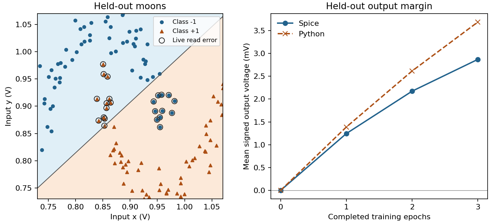

# A two-moons classifier built from varactor bridges

The six-cell nonlinear version scores **112/128** on the same held-out points and **463/512** on a fresh moons sample. It uses 18 trainable varactor bridges and a bank of current-steering transistors. Run it with `python run.py --activation bump`. [Nonlinear circuit, controls and decision boundary](NONLINEAR.md)

## Original diode circuit

In a nominal ngspice transient, 18 bridges learned from 64 labelled moons points and correctly classified 105 of 128 unseen points (82.03%). The test followed training in the same simulation. The weight capacitors stayed connected to their read transistors while the teacher and write switches were disabled. An otherwise identical run with the teacher disabled throughout scored 64/128.



The background shows the Python DC solution using the final SPICE capacitor voltages. Circles around examples mark errors measured in the physical-circuit simulation. The curves on the right use each model's own trained weights. The decision boundary is nearly straight. A logistic regression on the same two inputs scored 108/128 (84.38%). This pilot demonstrates that the bridges can accumulate a useful update across different examples. The small network has yet to demonstrate a nonlinear classification advantage.

## Circuit and timing

The inputs are the two raw coordinates, scaled per axis using training-set extrema and clipped to 0.73–1.07 V. A fixed bias node sits at 1.03 V. Four hidden nodes have diode shunts with alternating orientations and reference voltages 0.855 and 0.945 V. One bridge connects each hidden node to its corresponding input (two nodes per input). Each differential output connects to all four hidden nodes, both inputs and bias through seven more bridges. All 18 weights start at 1.55 V.

Each instance of [bridge.inc](bridge.inc) uses the original two unit junction varactors, a double-area midpoint reference junction, a 1 pF weight capacitor, two midpoint resistors and 14 MOSFETs. The bridge devices account for 252 MOSFETs across the network. The four hidden diodes, node capacitors and shared clock, bias and teaching sources are additional. The read transistor pair and midpoint resistors give approximately 55.5 µS per edge at initialization. The teacher is an ideal controlled current source between the outputs, equivalent while active to a 120 µS conductance pulling the differential voltage toward the class target (±140 mV).

| Time within a 62 µs example | Action |
|---|---|
| 1–5 µs | Ramp the inputs while each storage capacitor is isolated from its write bus. |
| 12 µs | Sample the free differential output for diagnostics. |
| 14 µs | Connect each writer to its weight capacitor. |
| 17–21 µs | Ramp the output teacher on. Its effect propagates through the network. |
| 38 µs | Sample the nudged differential output. |
| 39 µs | Isolate the weight capacitors while the teacher is still on. |
| 42–46 µs | Ramp the teacher off. |
| 60 µs | Record all weight voltages and the free output. |

The stored voltage continuously controls the read conductance. During the write interval, the current mirrors integrate the local signal-minus-reference displacement current onto that capacitor. The shared timing isolates the stored increment before the nudge is removed. During held-out inference all writes remain disabled and the target waveform stays at zero.

## Python model

[model.py](model.py) solves Kirchhoff's current law for the four hidden and two output voltages. It uses the complementary MOS pair's triode conductance plus the 0.5 µS midpoint shunt, and the Shockley equation for each hidden diode. In the matched bridge approximation, the sense voltage is 0.5 V. If the branch endpoints are A and B, the sensed charge is

```
q(v) = 2 Cj Vj [sqrt(1 + (v − Vsense)/Vj) − 1]
Q(A,B) = q(A) + q(B) − 2 q((A+B)/2)
```

Here Cj = 1 pF and Vj = 0.7 V. The first-order dependence on branch drop cancels about the midpoint. The leading surviving term is negative and quadratic in A−B, with a coefficient that depends on the midpoint voltage. The Python update first charge-shares the parked 2 fF bus with the store, then adds (Q_nudged − Q_free)/(1.002 pF). It solves the nudged voltages and live weights self-consistently. The approximation omits transistor switching transients, MOS parasitic capacitances and finite sense-node settling.

## Measured results

The reproducible split uses scikit-learn two moons with 192 examples, noise 0.10, dataset seed 12, stratified split seed 31 and shuffle seed 71. Three epochs give 192 training presentations. The predicted class is determined by the sign of the free output voltage difference, with ties at a 1 nV numerical floor assigned to class −1.

| Condition | Train accuracy | Held-out accuracy | Held-out mean signed margin |
|---|---:|---:|---:|
| Initial circuit, DC | 50.00% | 50.00% | 0.000 mV |
| SPICE after epoch 1, DC | 87.50% | 82.03% | 1.244 mV |
| SPICE after epoch 2, DC | 87.50% | 82.03% | 2.172 mV |
| SPICE after epoch 3, DC | 87.50% | 82.03% | 2.868 mV |
| SPICE, continuing transient with stored charge | — | 82.03% | 2.868 mV |
| SPICE, teaching current disabled throughout | — | 50.00% | 0.000 mV |
| Independently trained Python model after epoch 3 | 87.50% | 82.03% | 3.685 mV |

The final SPICE train score is 56/64. Held-out class −1 had 53 correct of 64 and class +1 had 52 correct of 64. The largest retained weight change was 51.67 mV with the teacher and 0.166 mV without it. The four input-to-hidden bridge weights each finished within 0.19 mV of initialization. The largest changes occurred on the direct input-to-output bridges.

The first 18-component write vector had cosine similarity 0.982 between the models. After three epochs the capacitor voltages differed by 6.48 mV RMS. The models agreed on all 128 held-out decisions, but Python overestimated the mean signed margin by 0.817 mV. A DC replay using the same SPICE weights agreed with the continuing transient on every decision, with 0.35 µV RMS differential-output error. Reducing the maximum timestep fourfold changed the sampled capacitor voltages by at most 1.12 µV across the first three presentations.

These are generic SPICE devices at 27 °C with matched transistors and junctions, zero mirror channel-length modulation, ideal shared controls and a 10¹⁶ Ω storage leakage resistance. The held-out sequence spans 7.936 ms. Long-term retention, process mismatch and noise require separate tests. The previous single-edge experiment found approximately −44 mV of false write at zero nudge from a 0.1% sink-mirror mismatch. The matched-network result inherits that hardware limitation.

## Reproduce

From this directory, using the repository's Python dependencies and ngspice 41:

```sh
python model.py
python run.py --ngspice /path/to/ngspice
```

The first command runs Python alone. The second runs supervised training, the zero-teaching control and a tighter-timestep check, then generates a report. Use `--out DIR` to select an output directory. The default is `outputs/moons_bridges/` at the worktree root.

The generated `learn/transient/network.cir` and its adjacent `bridge.inc` are the self-contained ngspice training and inference deck. From that directory, run `ngspice -b -n -r trace.raw network.cir` to retain the full waveform. The driver keeps the decks and logs, and stores the free, nudged and retained differential outputs, per-presentation weight voltages, held-out read voltages, and held-out capacitor voltages in `learn/training.npz`. The `dc_*` directories hold independent checkpoint readouts with the weight voltages clamped for comparison.

The recorded run includes [all 18 final weights](reference/trained_weights.csv), [per-example predictions](reference/predictions.csv) and [numerical results](reference/results.json).
