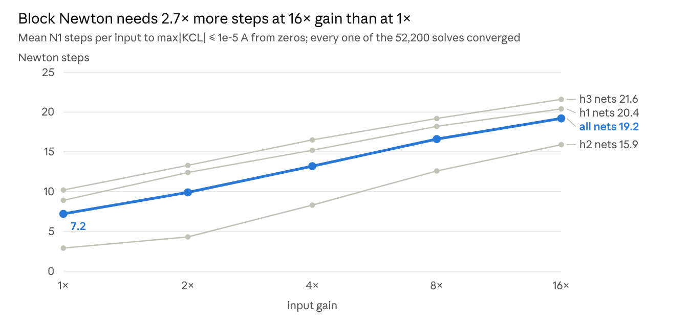
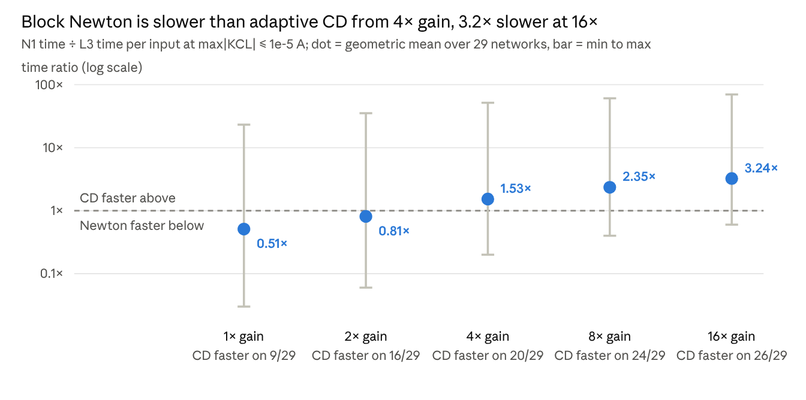

# Newton Solvers for the Nonlinear DRN: A Review

Oct 27, 2026 · Filip

## Summary

Armijo-damped block-Cholesky Newton (N1) is the solver to defend in the reviewer response, with dense-LU Newton as the baseline.

- It takes exactly the dense-LU steps at 4.6× lower cost (geometric mean, 2.0–104×). It converged on all 52,200 exp-017 paper-network solves.
- Its weakness is the step count. That rises from 7.2 to 19.2 mean steps between 1× and 16× gain, because nothing limits the junction overshoot.
- As a result, adaptive CD (L3) overtakes it from about 4× gain, and the lean CD (LITE) beats it on 139 of 145 network–gain pairs.
- Junction limiting and Newton–Krylov, the two variants that could change this picture, are designed but not yet built.

## Problem setting

Every Newton variant solves the same DC equilibrium of the layered DRN: Kirchhoff's current law at every free node, stacked into one system.

```latex
F(v) = A v - f + i(v) = 0, \qquad J(v) = A + \operatorname{diag}\big(i'(v)\big)
```

- **A** is block tridiagonal by layer. Its diagonal blocks are diagonal (no connections inside a layer), with 2a = colsum(W_l) + av·ai·rowsum(W_{l+1}). The off-diagonal blocks are −ai·W above and −av·W^T below.
- **J is not symmetric** for the paper's amplifiers (av = 4, ai = 1), but a fixed layer scaling makes it symmetric positive definite. The next section derives this structure and the three direct factorizations it permits.
- **f** is the clamped input through W_0 on the first free layer. exp-017 has no bias currents.
- **i(v)** is the device law on hidden nodes only: full antiparallel double Shockley (Is = 1 µA, V_T = 50 mV, V_off = 0.8 V), or the oriented single Shockley for single_* nets.

Size: n = sum of free widths. Double nets have 20 outputs and single nets 10, so double_h2w1024 has n = 2068.

**Stopping rules** shared by all variants (harness/solver.py):

- current: max|F| ≤ tol, in amperes. This is the primary stop in exp-017 (grid 1e-2 to 1e-10 A).
- voltage: max|F / diag(A)| ≤ tol, in volts.
- CD rule: max|Δv| ≤ rtol·max|v_old| + atol on the accepted step, for like-for-like comparison with the repository CD.

All runs start from v = 0 unless a linear-solution start is named. The Armijo merit function is always the conductance-scaled 2-norm ‖F/diag(A)‖₂, whichever stop is used.

## Jacobian structure: dense LU, block LU, block Cholesky

At each Newton iteration we solve J(v) Δv = −F(v). Dense LU, block LU and block Cholesky solve this same linear system; they differ in how much of its structure they use. With exact arithmetic and the same step rule, they give the same Newton iterates. Floating-point results can differ by roundoff.

Number the free layers j = 0, …, h: h hidden layers followed by the output layer. Let w_j be their widths, m = w_h the output width, and n = Σ_j w_j. The input is clamped and is not an unknown. With W_0 connecting the input to layer 0 and W_{j+1} connecting free layers j and j+1, the Jacobian is

```latex
J(v) =
\begin{bmatrix}
B_0 & E_0 & 0 & \cdots & 0 \\
C_0 & B_1 & E_1 & \ddots & \vdots \\
0 & C_1 & B_2 & \ddots & 0 \\
\vdots & \ddots & \ddots & \ddots & E_{h-1} \\
0 & \cdots & 0 & C_{h-1} & B_h
\end{bmatrix},
\qquad
E_j = -a_i W_{j+1}, \quad C_j = -a_v W_{j+1}^{\mathsf T},
```

```latex
B_j(v) = \operatorname{diag}\!\left[
\operatorname{colsum}(W_j)
+ a_v a_i\,\operatorname{rowsum}(W_{j+1})
+ g_j(v_j)\right],
\qquad g_j(v_j)=i'_j(v_j).
```

At the output, the outgoing-weight term is absent and g_h = 0. Every B_j is diagonal because there are no connections within a layer and each shunt depends only on its own voltage. The adjacent-layer blocks are generally dense; all other blocks vanish. Only g_j changes during Newton, so the off-diagonal blocks and the sparsity pattern stay fixed.

The distinction that matters for the solve is **diagonal before elimination, generally dense after elimination**. Eliminating one layer couples the nodes of the next through shared neighbours. Block methods retain those dense Schur complements while avoiding a dense matrix for the whole network.

### Dense LU: factor the full Jacobian

Assemble the n×n matrix and factor it with partial row pivoting, P J = L U, then solve the two triangular systems for Δv. This is the general-matrix route used by `backend='dense_lu'`; it makes no use of the layer pattern or the symmetrizing scale. Partial pivoting is the standard [LAPACK DGETRF](https://www.netlib.org/lapack/explore-html/db/d04/group__getrf_gaea332d65e208d833716b405ea2a1ab69.html) factorization.

The leading factorization cost is ⅔n³ flops, with O(n²) storage and O(n²) work for one right-hand side after factorization. For h hidden layers of width w, n = hw+m. Even with just one hidden layer, dense LU pays a cubic cost in w.

### Block LU: eliminate one layer at a time

Block LU uses the block-tridiagonal pattern directly on J. Write r = −F(v), and eliminate from the input side:

```latex
T_0 = B_0, \qquad \widehat r_0 = r_0,
```

```latex
T_j = B_j - C_{j-1}T_{j-1}^{-1}E_{j-1},
\qquad
\widehat r_j = r_j - C_{j-1}T_{j-1}^{-1}\widehat r_{j-1}
\quad (j=1,\ldots,h).
```

Then back-substitute from the output:

```latex
\Delta v_h = T_h^{-1}\widehat r_h, \qquad
\Delta v_j = T_j^{-1}(\widehat r_j-E_j\Delta v_{j+1}).
```

The inverse notation means linear solves; no inverse is formed. T_0 is diagonal, so its solves are divisions. Later T_j are generally dense and can be factored by LU, reusing each factor for the coupling block and the residual. This is block Thomas elimination by physical layer, distinct from the internal BLAS blocking used by a dense LU routine.

For comparable layer widths, the work scales as O(h w³) and storage as O(h w²), instead of dense LU's O(h³ w³) work and O(h² w²) storage when m is small. This remains cubic in width. For h1, the stronger saving comes from the diagonal first block: the only dense factorization is the m×m output Schur complement, giving O(wm²+m³) work.

For this DRN, the T_j equal the positive-definite Schur blocks derived below, so elimination does not require exchanging layers. A generic block-tridiagonal matrix does not have that guarantee. **Block LU is a structural comparison here:** `LayeredDRN.linear_step()` currently exposes dense LU and block Cholesky, with no separate block-LU backend or measured block-LU timings.

### Block Cholesky: use the layer structure and symmetry

The amplifier gains make J nonsymmetric, but the asymmetry is fixed across Newton steps. Define a diagonal scale that is constant within each layer:

```latex
D = \operatorname{blockdiag}(D_0,\ldots,D_h),
\qquad D_j=(a_i/a_v)^{j/2}I_{w_j},
\qquad S = D J D^{-1}.
```

The diagonal blocks remain B_j, while the upper and lower blocks become K_j and K_jᵀ, with K_j = −√(a_v a_i) W_{j+1}. Thus S is symmetric. For a_v = 4 and a_i = 1, the layer scales are 1, 1/2, 1/4, … . The equivalent Newton system is

```latex
S y = D r, \qquad y = D\Delta v, \qquad \Delta v = D^{-1}y.
```

Positive definiteness follows from the network's quadratic form. Each conductance c between free nodes p and q in consecutive layers contributes c(√(a_v a_i) x_p − x_q)²; each connection to the clamped input contributes c x_q²; and each shunt contributes g_p x_p². All are nonnegative for monotone shunts. The sum is strictly positive for nonzero x if every connected free component is anchored by an input connection or a positive shunt derivative. The paper's connected networks satisfy this condition; an unanchored component with zero shunt derivatives would only give positive semidefiniteness.

Elimination therefore preserves positive definiteness:

```latex
H_0 = B_0, \qquad
H_j = B_j-K_{j-1}^{\mathsf T}H_{j-1}^{-1}K_{j-1},
\qquad H_j=R_jR_j^{\mathsf T}.
```

Use the same forward elimination and back-substitution as above, with Kᵀ, K and the scaled right-hand side D r, then unscale the result. Since D_j is a scalar multiple of the identity within each layer, the block-LU T_j and these H_j are equal in exact arithmetic. Block Cholesky exploits their symmetry and positive definiteness when factoring them. The implementation is a block LDLᵀ elimination with a Cholesky factorization of each dense Schur block; [LAPACK DPOTRF](https://www.netlib.org/lapack/explore-html/d2/d09/group__potrf_ga84e90859b02139934b166e579dd211d4.html) supplies the SPD factorization without pivoting.

Factoring a dense w_j×w_j Schur block costs about ⅓w_j³ flops with Cholesky, versus ⅔w_j³ with LU. Both block methods still pay for coupling solves and Schur products, so this does not imply a twofold speedup of the whole solve. The current code forms Kᵀ(H⁻¹K) with a general matrix product. A Cholesky implementation can instead use Z = R⁻¹K and form ZᵀZ with a symmetric rank-k update; that optimization is not yet used here.

| Linear solve | Structure used | Work for h comparable hidden layers, m ≪ w | h1 work | Available backend |
| --- | --- | --- | --- | --- |
| Dense LU | General nonsymmetric matrix | O((hw+m)³) | O((w+m)³) | `dense_lu` |
| Block LU | Block tridiagonality and diagonal first block | O(hw³), for h ≥ 2 | O(wm²+m³) | None; comparison only |
| Block Cholesky | Same layer structure, plus diagonal symmetrization and SPD Schur blocks | O(hw³), for h ≥ 2, with cheaper block factorizations | O(wm²+m³) | `block_cholesky` |

The large h1 saving comes from eliminating the diagonal hidden block and factoring only the small output block. With h2/h3, elimination creates dense hidden-layer Schur complements, and cubic work in the hidden width remains. These are linear-algebra savings; they do not by themselves reduce Newton's iteration count.

*Implementation reference: [Jacobian assembly and linear solve](/home/filip/nonlinear-drn-paper/reviews/solvers/solver.py:155). The operation counts above describe arithmetic scaling, not measured timings.*

## What ELDO solves

ELDO solves the same equilibrium, but in a larger formulation. Its unknowns include the amplifiers' internal nodes and branch currents. Eliminating those exactly gives back J(v) above.

**Circuit.** The paper netlist builds each hidden neuron as a subcircuit with two nodes, VIN and VOUT:

- the behavioural GEXP shunt diodes sit on VIN;
- a VCVS imposes V(VOUT) = a_v·V(VIN);
- a CCCS injects a_i times the VCVS branch current back into VIN;
- resistors connect each VOUT to the next layer's VIN nodes.

Output nodes are plain nodes. The inputs are grounded voltage sources (VAC1…VAC128, the signed-pair inputs times the gain), so ELDO eliminates them.

**Unknowns.** Modified nodal analysis (MNA) keeps three groups:

- u: VIN of every hidden neuron and the output nodes, which are the n unknowns v of the local solver;
- y: VOUT, one per hidden neuron;
- I: the VCVS branch current, one per hidden neuron.

Each hidden neuron therefore carries three unknowns (VIN, VOUT, I) where the local solver has one (VIN); output nodes carry one in both. That gives N = n + 2·Σ_{j<h} w_j equations. These are ELDO's own equation counts, read from each run's `netlist.chi`:

| Net | ELDO equations | Local unknowns | Ratio |
| --- | ---: | ---: | ---: |
| h1w128 | 3·128 + 20 = 404 | 148 | 2.7 |
| h2w128 | 3·256 + 20 = 788 | 276 | 2.9 |
| h3w256 | 3·768 + 20 = 2,324 | 788 | 2.9 |
| h2w512 | 3·1,024 + 20 = 3,092 | 1,044 | 3.0 |

The ratio stays slightly under 3 because the 10–20 output nodes count once on both sides. It is 3 times as many unknowns, not 2: VIN and VOUT account for a factor of 2, and the VCVS branch current I for the third.

**Why ELDO carries I.** MNA builds its equations element by element, with one KCL row per node. Each element adds ("stamps") its current into the rows of the nodes it touches, and that current must be expressible in the unknowns:

| Element | Current in terms of the unknowns | Extra unknown |
| --- | --- | --- |
| Resistor | i = g·(V_a − V_b): conductance entries | none |
| Diode (each Newton iteration) | tangent conductance + current source | none |
| Current-controlled current source | a known multiple of an existing unknown | none |
| Voltage source, including the VCVS | not expressible | branch current I, plus one constraint row |

A voltage source fixes a voltage, not a current. Its law, here V(VOUT) − a_v·V(VIN) = 0, says nothing about the current it delivers. An ideal source supplies whatever the load draws, so the current depends on the rest of the circuit. MNA therefore adds the branch current I as an unknown, which appears in the VOUT KCL row, and the source's law as an extra row. These are the third block row and the I column of the matrix below.

In this circuit I is needed a second time. The CCCS is a SPICE F element, and an F element is controlled by the branch current of a voltage source, here the VCVS. I must exist as an unknown for the CCCS to refer to.

**Why the local solver can drop it and ELDO does not.** I enters linearly. From the VOUT row, it is the current flowing out through the resistors to the next layer:

```latex
I = -\big(G_{yu}\,u + G_{yy}\,y\big).
```

Substituting it, together with VOUT = a_v·VIN, into the VIN rows removes both unknowns. This is where the a_v a_i·rowsum(W) term and the nonsymmetric off-diagonal blocks of J come from. The local solver can do this because every neuron has the same known structure. ELDO keeps the per-element stamps because they work for any netlist. An ideal source would be an infinite conductance, so it cannot be stamped as one. The extra rows are cheap per element, but here they add 2 unknowns per hidden neuron.

ELDO could avoid I only with a different circuit. For example, the amplifier could be modelled as a VCCS with a large output conductance (a Norton equivalent). That is no longer an ideal VCVS, and the large conductance would worsen the matrix conditioning. With the paper netlist, the third unknown is unavoidable.

**Newton system.** Every ELDO iteration replaces each diode by its tangent conductance g = i′(u) plus a current source, and solves

```latex
\begin{bmatrix}
G_{uu} + \operatorname{diag}(g) & G_{uy} & -a_i P \\
G_{yu} & G_{yy} & I \\
-a_v P^{\mathsf T} & I & 0
\end{bmatrix}
\begin{bmatrix} \Delta u \\ \Delta y \\ \Delta I \end{bmatrix}
= -\begin{bmatrix} F_u \\ F_y \\ F_I \end{bmatrix}.
```

The blocks are:

- G_uu: the incoming conductances, colsum(W_j), which form a diagonal;
- G_yy: the outgoing conductances, rowsum(W_{j+1}), which also form a diagonal;
- G_uy = G_yuᵀ: the −W couplings from each VOUT to the next layer's VIN;
- P: the matrix that selects hidden nodes from u;
- the third block row: the VCVS constraint;
- the −a_i P column: the CCCS.

**Reduction to J.** Eliminate y and I, which appear linearly. The VCVS row gives Δy = a_v PᵀΔu, and the VOUT row then gives ΔI. Substituting both into the VIN row leaves

```latex
\big(G_{uu} + \operatorname{diag}(g) + a_v a_i\,P G_{yy} P^{\mathsf T} + a_v G_{uy} P^{\mathsf T} + a_i P G_{yu}\big)\,\Delta u = -F_u ,
```

which is J(v) term by term:

- a_v a_i·P G_yy Pᵀ is the a_v a_i·rowsum(W_{j+1}) part of B_j;
- a_v G_uy Pᵀ is the lower block C_j = −a_v W_{j+1}ᵀ;
- a_i P G_yu is the upper block E_j = −a_i W_{j+1}.

`eldo_linear_algebra_20261022` rebuilds this matrix from archived netlists, and its equation and nonzero counts match ELDO's own. Its Schur complement reproduces the MNA solve to ≤ 2e-14. The equations and the equilibrium are therefore identical; the difference is in how each solver reaches it.

**How ELDO solves it.** ELDO uses Newton–Raphson with a general sparse LU of the full N×N MNA matrix.

- **No structure is exploited.** ELDO does not eliminate the amplifier unknowns or use the layer pattern or the symmetrizing scale. On the MNA matrix, dense LU costs 13–19× the reduced dense LU.
- **Sparsity gives no advantage.** The dense inter-layer blocks fill the sparse factors to 13–18%, so SuperLU on the MNA matrix is 0.7–1.9× dense LU.
- **The pivot order is chosen again for every analysis.** perf attributes about 60% of samples to ELDO's own matrix code (`m1_insert`, `link_jcol`, `rechain_*`) and 16–28% to `LUDEC_minv`.
- **No junction limiting.** The GEXP diodes are behavioural sources, so ELDO's Newton has no `pnjlim`, the same as ours.
- **The stop is an update tolerance.** ELDO stops on its RELTOL/VNTOL criteria, not on a KCL residual. E1 keeps the defaults, E2t uses RELTOL 1e-6 and VNTOL 1e-9, and E2l uses RELTOL 1e-2 and VNTOL 1e-4. It needs at least 3 iterations to confirm convergence.
- **Start.** A `.DC DATA` sweep warm-starts each input from the previous one. The paper's interactive loop (`SET P` + `RUN`) instead starts a new analysis for every input.

Once the linear VCVS and VOUT rows hold, a full MNA Newton step equals a full step on J. Iteration counts therefore differ only through the start, the stop rule and ELDO's own step control, and they are comparable in practice (0.9–3× ours).

ELDO's gap to the local Newton is then iterations × formulation × sparse vs dense × ELDO's per-analysis overhead (decomposed in the performance section). Its default `.PRINT` keeps 5 significant digits, which sets the ~1e-5 floor of the archived SPICE states; the E1p/E2tp/E2lp variants print 10.

## The variants

The two implementations reviewed here share one Newton loop (`newton()` in `reviews/solvers/solver.py`, copied into the exp-017 bundle as `harness/solver.py`) and the same Armijo step rule. They differ only in the linear solve. Block LU is covered above as a structural comparison; junction limiting and Newton–Krylov remain planned extensions.

### 1. Dense-LU Newton (`backend='dense_lu'`)

The baseline. Each step builds the full n×n Jacobian and calls `scipy.linalg.solve` as a general matrix (LAPACK getrf, ⅔n³ flops), followed by an Armijo backtracking line search. It ignores all structure: diagonal blocks, block tridiagonality, and symmetrizability.

- Used in: exp-001, the MNIST h1 study at gain 60 (exp-006), and the `newton_dense_lu` arm of `established_gain_20261022`.
- One solve on h2w1024 costs 140–232 ms, of which LU factorization is 164 ms. Another 22–34% goes to the matrix copy, temporaries and SciPy's condition estimate.

### 2. Block-Cholesky Newton (`backend='block_cholesky'`, exp-017 arm N1)

Same Newton loop, same steps, different linear solve. It symmetrizes J with D_j = (ai/av)^(j/2) and runs a block LDLᵀ elimination from the input side ("block Thomas"):

1. Layer 0 is diagonal, so it is a division, with no factorization.
2. Each later layer forms the Schur complement diag(d_j) − Lᵀ S̃⁻¹ L and factors it with an unpivoted Cholesky, which is safe because S is SPD.
3. Back-substitution runs from the output side, then the result is unscaled.

On h1 nets the only Cholesky is the 10×10 or 20×20 output block, so one solve is 7–640× faster than LU. On h2/h3 the gain is 2.5–3.8×; the general Schur product (2w³) dominates. Dense LU and block Cholesky agree to 2e-12 on random circuits (`test_solver.py`). This is the Newton the reviewers' comparison should use, and it is the default.

### Designed, not implemented

- **Junction-limited Newton** (cd-newton-gain H-004). This adds SPICE-style `pnjlim` limiting on each diode branch voltage |v| − V_off on top of Armijo. It addresses the fairness concern that SPICE limits junction overshoot while our Newton does not. No code exists yet; exp-001 and exp-003 of that campaign are planned.
- **Newton–Krylov** (cd-newton-eldo H-005, exp-012). This uses inexact Newton with PCG on the SPD reduced Jacobian, preconditioned by the input-independent linear network factored once. It tests whether CD's edge is simply "no factorization". It is planned.

The reference SPICE solver, ELDO, is itself a Newton on the MNA formulation (see "What ELDO solves"), with behavioural GEXP diodes and no junction limiting. It is compared in the performance section but is not one of ours.

## Convergence and robustness

Armijo-damped block Newton has not failed a paper-network solve: all 52,200 exp-017 solves (29 networks × 5 gains × 360 inputs) reach 1e-5 A. Its cost is the step count, which grows with input gain.



*Source: exp-017 accuracy table (`reviews/figures/exp017/tables/accuracy.csv`), arm N1, current_1e-05 stop; 29 networks × 360 inputs per gain; per-network means averaged.*

- **Steps track the overshoot.** From zeros, the first full step lands near the diode-free linear solution, which overshoots V_off by many V_T at high gain. Armijo then backtracks, and Newton walks down the exponential. Gain scales the overshoot, so it scales the steps (worst case 17 at 1×, 30 at 16×). This explanation is cd-newton-gain H-001 and is not yet tested formally.
- **h2 nets are near-linear at 1×.** They need 2.9 steps at 1× because several trained h2 checkpoints barely turn their diodes on.
- **No junction limiting is the main weakness.** Starting from the linear solution at 8× makes Newton 2.5–5× slower, and it overflows on h1 nets and single h3w512 (`tolerance_start_20261022`). CD from the same start is unaffected (±5%). The planned `pnjlim` variant targets exactly this.
- **Newton held where CD failed.** Before the exp_clip fix, dense-LU Newton passed 360/360 on MNIST h1 at gain 60, while the benchmark-profile CD passed the 10 µA audit on only 62–93/360 (exp-006).
- **FP32 sets a floor, not the algorithm.** In FP32 the independent long-double KCL audit passes 351/360 at 1e-5 A on h1w128.

## Performance

Block Cholesky is the decisive implementation choice: it makes Newton 4.6× faster than dense LU end to end, with no change in steps. Even so, adaptive CD overtakes it from about 4× gain.



*Source: exp-017 timing table (`reviews/figures/exp017/tables/timing.csv`), current_1e-05 stop, local i9 core 0, 60 timing inputs (`np.linspace(0, 359, 60)`); L3 time includes a per-sweep residual check worth 1.3–1.9×.*

**Newton against Newton**

- **Dense LU → block Cholesky:** the steps are the same, and the speedup is 2.0–104×, geometric mean 4.6× (`established_gain_20261022`, 22 checkpoints, 360 inputs). The largest gains are on h1 nets, where the block solve never factors the hidden layer.
- **Of that saving, symmetry alone is worth 1.9–2.1×.** A dense Cholesky of S already gets it. The layer structure adds 3–230× on h1 nets but only 1.2–1.5× on h2/h3, where a general 2w³ Schur product dominates.
- **Cost per step** (fitted on exp-017): 0.11 ms per layer + 1.4 ns per weight + 76 ps·(d−1)·w³ + 168 ps·max(d−2, 0)·w³. A CD sweep costs 0.18 ms per layer + 0.75 ns per weight, with no w³ term.

**Newton against CD and SPICE**

- **Against framework CD (L3),** N1 is faster at 1–2× gain and slower from 4×. At 1e-9 A the crossover moves up to about 4× (geometric mean 1.09×), because Newton's quadratic tail is cheap.
- **Against LITE** (the same CD iterates without framework overhead), N1 loses on 139/145 pairs at 1e-5 A, with a geometric mean of 8.3×. It wins only where it needs about one step (near-linear nets at 1–2×). N1 itself has not been leaned out (NumPy per-step overhead), so small-net margins are upper bounds.
- **Hybrid:** CD to 1e-2 A, then 1–2 block-Newton steps, is 1.15–2.1× faster than CD alone at 1e-9 A. At 1e-5 A one block step on w = 1024 (about 57 ms) costs as much as about 20 sweeps, so the hybrid pays only at tight tolerances.
- **Against ELDO,** local Newton is 80–4,100× faster per input than the paper's interactive ELDO loop. Most of that is ELDO's per-analysis setup: batch `.DC DATA` is 12–33× cheaper per input. The remaining 11–53× is formulation (MNA has about 2.9× the unknowns) times iterations.

## Side by side

Block-Cholesky Newton (N1) is the solver to cite, with dense LU as the baseline. The planned extensions are listed for context.

| Variant | Code | Linear work per step | Step rule | Steps vs N1 | Where it is used | Verdict |
| --- | --- | --- | --- | --- | --- | --- |
| Block Cholesky (N1) | `solver.py`, `backend='block_cholesky'` | Schur product + Cholesky per layer after the first; O(w·m²) on h1 | Armijo | same | exp-017, established_gain | Default; the fair Newton for R1.3 |
| Dense LU | `solver.py`, `backend='dense_lu'` | ⅔n³ general LU of the full J | Armijo | same | exp-001, exp-006 (MNIST), established_gain | Baseline only; 4.6× slower than N1 |
| Junction-limited | none (cd-newton-gain H-004) | as N1 | `pnjlim` + Armijo | — | planned | Not implemented |
| Newton–Krylov | none (cd-newton-eldo H-005) | PCG, linear-network preconditioner | Armijo | — | planned (exp-012) | Not implemented |

## Open issues and next steps

The biggest gap is that our Newton has no junction limiting. A reviewer can fairly say that SPICE-grade Newton would take fewer steps at high gain.

- [ ] **Implement junction-limited Newton (H-004).** Add `pnjlim` on |v| − V_off to N1 and rerun the high-gain pairs. It also makes the linear-solution start usable, which currently overflows.
- [ ] **Lean out N1 before quoting LITE margins on small nets.** Remove the NumPy per-step overhead and the `np.diag` and temporary allocations (about 17% of h2w1024). Form the symmetric Schur product with a syrk (about half its flops).
- [ ] **Run Newton–Krylov (H-005, exp-012).** It is the clean test of whether CD's advantage is just "no factorization".
- [ ] **Re-time at 360 inputs if these numbers enter the paper.** exp-017 local timing used 60 inputs (`np.linspace(0, 359, 60)`); accuracy and step counts used all 360.
- [ ] **Settle the stop rule (cd-newton-gain H-005).** Compare the Jacobian-scaled residual with the voltage-change stop across gains and methods.
